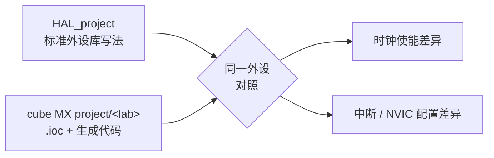

# STM32 CubeMX 与标准库工程集

**同一个外设，HAL 和 StdPeriph 各写一遍，差在哪一眼看出来**

[怎么用](#2-怎么用) · [体积约定](#3-体积治理约定) · [全部仓库索引](https://github.com/xhtfps/xhtfps)

## 这个仓的用法

不是拿来抄的代码库，而是**对照表**：同一个 LED/KEY/TIM/USART/ADC，左边看 `HAL_project` 的标准库写法，右边看 CubeMX 生成的 HAL 写法。差异最集中的两处——时钟使能与中断配置——对着看两遍就记住了。

## 亮点

- **每个 lab 带 `.ioc`**：想改配置就回 CubeMX 重新生成，不必手改 `Core/` 里的生成段落。
- **clone 即可编译**：各 lab 自带 `Drivers/`（HAL + CMSIS），不依赖外部库路径。
- **覆盖常用外设**：GPIO、USART、TIM、ADC、I2C、SPI、FreeRTOS，够撑起一个完整入门路径。
- **只留有价值的文件**：重复 CMSIS 副本与 10 MB 逐文件清单已移除，仓库不再臃肿。

## 结构

## 1. 工程清单与对应外设

| 工程目录 | 外设 / 主题 | 说明 |
| --- | --- | --- |
| `HAL_project/` | GPIO、USART、TIM | 标准库模板，学寄存器与外设库差异的基准 |
| `cube MX project/` 下各 lab | LED / KEY / TIM / USART / ADC / I2C / SPI / FreeRTOS | CubeMX 生成，每个 lab 一个独立 `.ioc`，可直接重新生成 |

每个 lab 自带完整 `Drivers/`（HAL + CMSIS），**clone 即可用 Keil / CubeIDE 打开编译**，不需要额外拉依赖。

## 2. 怎么用

1. 用 STM32CubeIDE 或 Keil（需装对应器件包）打开 `cube MX project/<lab>` 下的工程文件。
2. 想改配置：用 CubeMX 打开同目录 `.ioc`，重新生成代码后再编译，避免手改 `Core/` 里的生成段落。
3. 对照学习：先看 `HAL_project` 的 StdPeriph 写法，再看同名 lab 的 HAL 写法，差异最集中的是时钟使能与中断配置两处。

## 3. 体积治理约定

- 只收录**可版本化的源码、文档与小型资源**；编译中间产物、IDE 缓存、安装包、视频、镜像、数据集与模型权重按规则排除。
- 各 lab 重复的 CMSIS 副本（13 MB）已移除，提交 `91daec0d`；只依赖该副本的工程需从 ST 官网补回。
- 10 MB 的逐文件清单 `EXCLUDED_MANIFEST.csv` 改为 [`EXCLUDED_FILES.md`](EXCLUDED_FILES.md) 摘要；逐文件明细临时生成，不入库。
- 第三方资料版权归原作者，仅作学习参考。

## 4. 状态

在用。新 lab 按“一 lab 一目录、带 `.ioc`、不放大文件”的约定增量添加。

## 大文件去哪了

本仓已做过体积治理：大文件从当前分支移出，但历史提交完整保留，随时可取回。

- **其它产物**：各 lab 重复的 CMSIS 副本 13 MB 与 10 MB 逐文件清单 CSV，提交 `91daec0d`。
- **完整台账**：[`notes/offload.json`](https://github.com/xhtfps/notes/blob/main/offload.json)（repo / path / size / base_commit）；恢复口径见 [`SLIM-PLAN.md`](https://github.com/xhtfps/xhtfps/blob/main/SLIM-PLAN.md)。

clone 后发现某个文件不在，按台账里的 `base_commit` 打开 `https://github.com/xhtfps/<repo>/blob/<base_commit>/<path>` 取回即可，不要重复提交进仓。
## 路线图

- [x] 各 lab 的重复 CMSIS 副本清理，逐文件清单压成摘要
- [x] 统一「一 lab 一目录 + 带 `.ioc`」的增量约定
- [ ] 补一份「HAL vs StdPeriph 差异速查表」（时钟、GPIO、中断、DMA 四类）
- [ ] 把常用 BSP 初始化收敛到 `bsp-libs`

## 参与与反馈

- 遇到问题请走 [Issue 模板](.github/ISSUE_TEMPLATE)，注明 lab 名称与 CubeMX / IDE 版本。
- 提 PR 前先读 [CONTRIBUTING.md](CONTRIBUTING.md)；安全问题按 [SECURITY.md](SECURITY.md) 私下反馈。
- 如果这个仓库帮你省过时间，点个 ⭐ 是最省事的支持。

## 许可证

本仓自写代码以 [MIT](LICENSE) 分发；ST HAL、CMSIS 与 CubeMX 生成代码按 ST 的许可条款使用。
